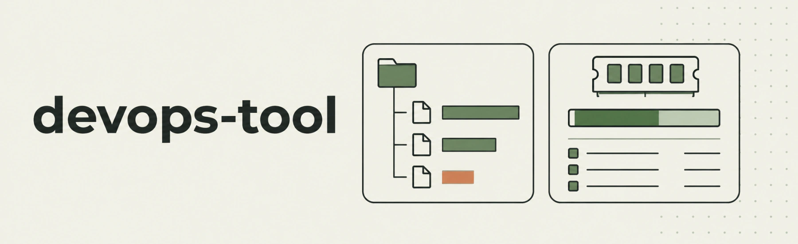
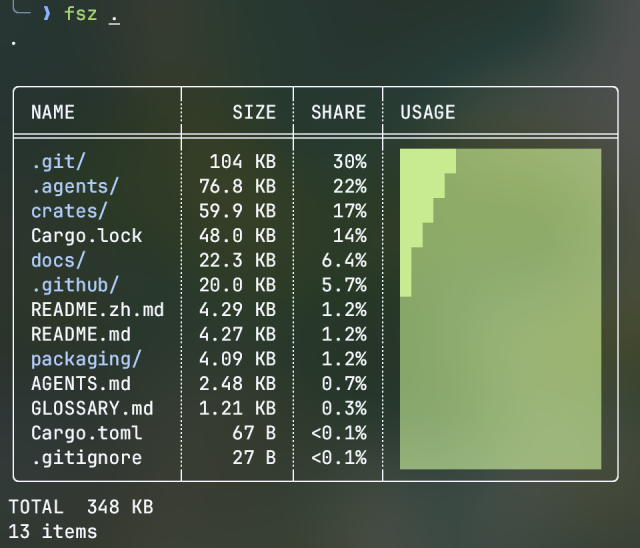
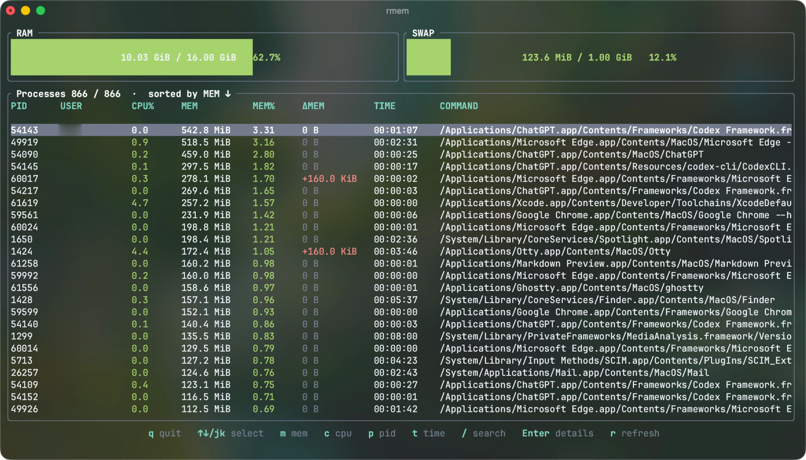

# 

[简体中文](README.zh.md) · [Screenshots](#screenshots) · [Install](#install) · [Platform status](#platform-status)

Two published Rust command-line tools for your local machine. Use [`fsz`](#fsz) to see how large files and folders are. Use [`rmem`](#rmem) to see which processes are using memory. The source-only [`lfd`](crates/lfd/README.md) inspects potential app uninstall leftovers on macOS.

<p align="center">
  <a href="#fsz"></a>
  <a href="#rmem"></a>
</p>

## Screenshots

### fsz

Run `fsz .` for a size breakdown of the current directory. Each row shows one immediate entry. A subdirectory's size includes the files counted inside it.

[](docs/assets/readme/fsz.webp)

Sizes are logical bytes, measured from file contents. See the [`fsz` guide](crates/fsz/README.md) for scan boundaries, symbolic links, and partial results.

### rmem

Run `rmem` in an interactive terminal to monitor local processes, RAM, and swap. The read-only view refreshes once a second and initially sorts by resident memory.

[](docs/assets/readme/rmem.webp)

Press `/` to search by PID, user, name, or command. Press `Enter` to apply the search and again to open the selected process. Press `Esc` to return to the list and `q` to quit. See the [`rmem` guide](crates/rmem/README.md) for all keys and metric definitions.

## Install


Published binaries target **macOS arm64**, **Linux x64 (glibc)**, and **Windows x64**. See the [latest GitHub Release](https://github.com/mel0nyrame/devops-tool/releases/latest) for binaries and checksums.

### npm or Bun

Install both tools with either command.

```sh
npm install -g @melonyrame/devops-tool
# Or use Bun
bun add -g @melonyrame/devops-tool
```

To install just one tool, replace the package name with `@melonyrame/fsz` or `@melonyrame/rmem`. Uninstall the old package before switching between the suite package and a single-tool package.

Global commands use Node. With Bun alone, run `bunx --bun -p @melonyrame/fsz fsz .` or `bunx --bun -p @melonyrame/rmem rmem`.

### Standalone installer

Run these commands in a Unix shell. On Windows, use Git Bash.

```sh
curl -fsSLo install.sh https://github.com/mel0nyrame/devops-tool/releases/latest/download/install.sh
sh install.sh
```

The installer checks the SHA-256 of each binary and writes it to `$HOME/.local/bin`. Set `INSTALL_DIR` to choose another directory. Pass `fsz` or `rmem` to install one tool, or use `sh install.sh all vX.Y.Z` to pin a version. Add the installation directory to `PATH` if needed. To uninstall, remove the installed executable files.

### Build from source

Use Cargo and Rust 1.95 or newer. From the repository root, run one or both commands.

```sh
cargo install --locked --path crates/fsz
cargo install --locked --path crates/rmem
```

If needed, add Cargo's bin directory to `PATH`. The default is `$HOME/.cargo/bin` on Unix or `%USERPROFILE%\.cargo\bin` on Windows.

To try the tools directly from the checkout, run `cargo run --locked -p fsz -- .` or `cargo run --locked -p rmem`.

## Platform status

The [native CI workflow](.github/workflows/ci.yml) builds and tests `fsz` and `rmem` on Windows, macOS, and Linux.

| Platform | `fsz` scan check | `rmem` terminal check |
| --- | --- | --- |
| macOS and Linux | Symbolic links in CI | Interactive check in CI |
| Windows | Symbolic links and junctions in CI | Local x64 GNU check in CMD via WinPTY |

The `fsz` check expects **8 B** when the scan skips a nested directory symlink and **13 B** when the symlink is the input. The `rmem` check covers PID search, matching process details, `Esc` to return to the list, and `q` to return to a working shell.

The initial read-only `lfd` inspection was built and smoke-tested natively on macOS arm64 (26.7.3). `lfd` does not support Windows or Linux.

[Glossary](GLOSSARY.md) · [Design decisions](docs/adr/)
