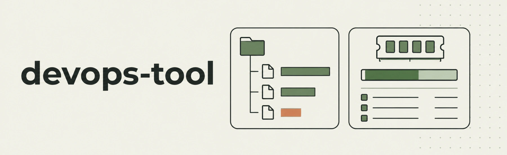
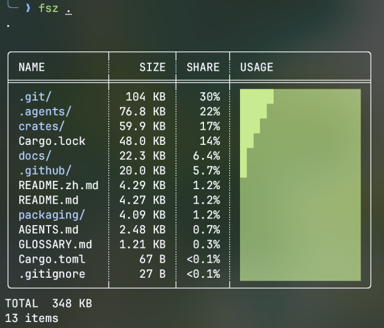
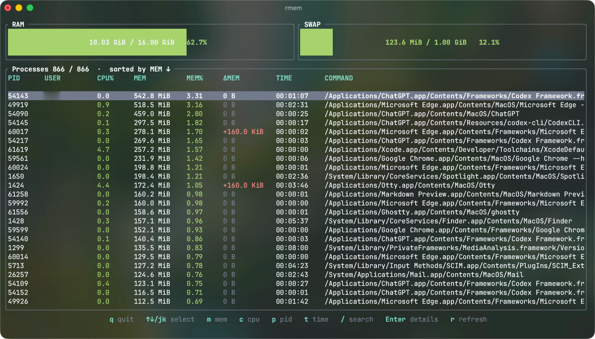

# 

[English](README.md) · [运行截图](#运行截图) · [安装](#安装) · [平台状态](#平台状态)

两个已发布的 Rust 命令行工具，用于查看本机状态。用 [`fsz`](#fsz) 查看文件和目录的大小。用 [`rmem`](#rmem) 查看哪些进程占用内存。仅从源码运行的 [`lfd`](crates/lfd/README.zh.md) 可在 macOS 上检查可能的应用卸载残留，并将核实归属的应用容器移到废纸篓。

<p align="center">
  <a href="#fsz"></a>
  <a href="#rmem"></a>
</p>

## 运行截图

### fsz

运行 `fsz .`，查看当前目录下各项的大小。每行显示当前目录下的一项。子目录的大小包含扫描到的内部文件。

[](docs/assets/readme/fsz.webp)

表格显示逻辑大小，按文件内容的字节数计算。扫描边界、符号链接和部分结果的说明见 [`fsz` 使用指南](crates/fsz/README.zh.md)。

### rmem

在交互式终端中运行 `rmem`，查看本机进程、物理内存和交换空间。界面为只读，每秒刷新一次。进程默认按驻留内存从高到低排列。

[](docs/assets/readme/rmem.webp)

按 `/` 可按 PID、用户、名称或命令搜索。按 `Enter` 应用搜索，再按一次打开所选进程的详情。按 `Esc` 返回列表，按 `q` 退出。完整按键和指标说明见 [`rmem` 使用指南](crates/rmem/README.zh.md)。

## 安装


已发布的二进制文件适用于 **macOS arm64**、**Linux x64（glibc）** 和 **Windows x64**。下载文件及其校验值见 [GitHub 最新版本](https://github.com/mel0nyrame/devops-tool/releases/latest)。

### npm 或 Bun

任选一条命令安装两个工具。

```sh
npm install -g @melonyrame/devops-tool
# 或使用 Bun
bun add -g @melonyrame/devops-tool
```

如需只安装一个工具，将包名换成 `@melonyrame/fsz` 或 `@melonyrame/rmem`。在套件包和单工具包之间切换前，先卸载旧包。

全局命令依赖 Node。只有 Bun 时，运行 `bunx --bun -p @melonyrame/fsz fsz .` 或 `bunx --bun -p @melonyrame/rmem rmem`。

### 独立安装脚本

在 Unix shell 中运行以下命令。Windows 上使用 Git Bash。

```sh
curl -fsSLo install.sh https://github.com/mel0nyrame/devops-tool/releases/latest/download/install.sh
sh install.sh
```

脚本校验每个二进制文件的 SHA-256，然后将文件安装到 `$HOME/.local/bin`。设置 `INSTALL_DIR` 可指定其他目录。传入 `fsz` 或 `rmem` 可只安装一个工具。运行 `sh install.sh all vX.Y.Z` 可指定版本。如有需要，将安装目录加入 `PATH`。卸载时，删除该目录中对应的可执行文件。

### 从源码构建

使用 Cargo 和 Rust 1.95 或更新版本。在仓库根目录按需运行一条或两条命令。

```sh
cargo install --locked --path crates/fsz
cargo install --locked --path crates/rmem
```

如有需要，将 Cargo 的二进制目录加入 `PATH`。Unix 上的默认目录为 `$HOME/.cargo/bin`。Windows 上的默认目录为 `%USERPROFILE%\.cargo\bin`。

如需直接从源码试用，运行 `cargo run --locked -p fsz -- .` 或 `cargo run --locked -p rmem`。

## 平台状态

[原生 CI 工作流](.github/workflows/ci.yml)在 Windows、macOS 和 Linux 上构建并测试 `fsz` 和 `rmem`。

| 平台 | `fsz` 扫描检查 | `rmem` 终端检查 |
| --- | --- | --- |
| macOS 和 Linux | CI 检查符号链接 | CI 检查终端交互 |
| Windows | CI 检查符号链接和目录联接 | 在本机 x64 GNU 环境中通过 CMD 和 WinPTY 检查 |

`fsz` 跳过嵌套目录符号链接时应显示 **8 B**。将该链接直接作为输入时应显示 **13 B**。`rmem` 检查覆盖按 PID 搜索、打开匹配进程的详情、按 `Esc` 返回列表，以及按 `q` 退出后继续使用 shell。

`lfd` 已在 macOS arm64（26.7.3）通过原生构建和冒烟检查；清理预览、确认和废纸篓移动使用隔离测试数据验证。`lfd` 不支持 Windows 或 Linux。

macOS CI 会运行 `lfd` 的默认构建和隔离构建冒烟检查。

[术语表](GLOSSARY.md) · [设计决策](docs/adr/)
